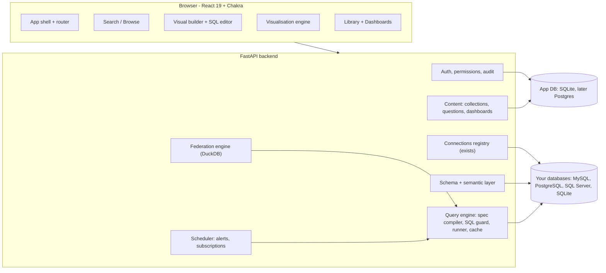
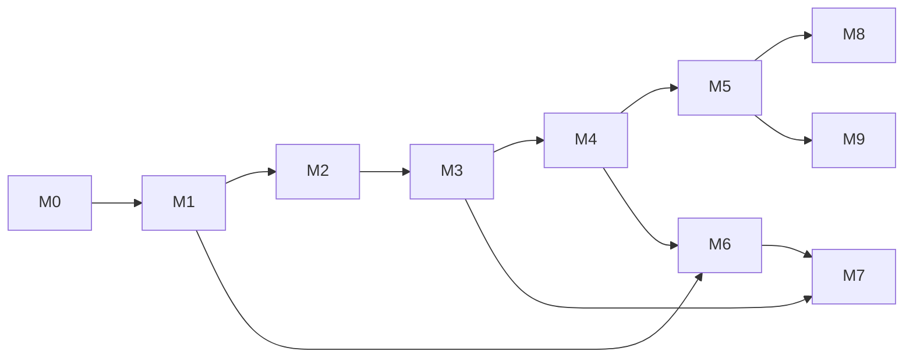
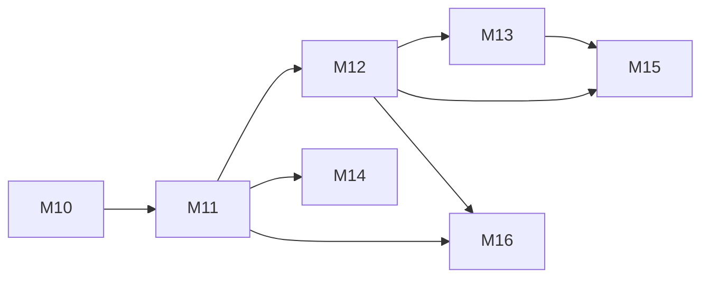

# Ncode → data work & analysis platform

**Status:** agreed plan v1 · M0–M7 delivered, waiting for their checklists · **Owner:** Mark · **Last updated:** 2026-10-11

This document is the single source of truth for where Ncode is going. It contains the
analysis of the *DataDesk* low-code project ("Low-code-draft"), what we borrow from it, the
target architecture, and the milestone plan we will stick to. Changes to the plan are recorded
in the [changelog](#14-changelog) at the bottom.

---

## 1. Vision

Ncode today answers *"where is this value in my database?"* (search, browse, export).
The goal is to grow it into a **self-hosted data work and analysis platform in the spirit of
Metabase Pro**, for people who work with several different databases:

| Pillar | What the user can do |
|---|---|
| **Explore** (exists) | Search every table, browse rows, export CSV |
| **Ask** | Build questions visually (no SQL) or write SQL, with safe, fast, cancellable execution |
| **Visualise** | Turn any result into charts, KPI cards, pivot tables; format and style them |
| **Combine** | Join results across databases and uploaded files |
| **Organise & share** | Save questions into collections, build dashboards with filters, share and schedule |
| **Understand** | Profile columns, auto-explore tables, period-over-period and statistical tools, a semantic layer (models, metrics, field metadata) |

*Metabase is our product inspiration only. Its code is AGPL and we do not copy it; everything
here is designed and written for Ncode.*

**Non-goals (for now):** writing/editing data (Ncode stays read-only) · arbitrary Python/R
notebooks (remote code execution risk; revisit sandboxed) · ETL pipelines · streaming/real-time
· mobile apps.

---

## 2. Baseline: what Ncode already has

Python/FastAPI + SQLAlchemy backend, React 19 + Chakra v2 frontend. Multi-engine support
(MySQL, MariaDB, PostgreSQL, SQL Server, SQLite), connections managed in the UI with encrypted
passwords, login with roles + per-user connection access + audit log, search across all tables,
table browser with paging/sort/filter, CSV streaming export, light/dark theme, tests.

All of that stays and keeps working; the new platform is built on top of it.

---

## 3. What DataDesk contains

DataDesk is a Node/TypeScript (Express + Knex + MySQL) backend with a React 18 frontend,
≈4,500 lines in total.

| Area | How it works | Verdict |
|---|---|---|
| **Structured query spec** | JSON spec `{database, from, joins, select[+aggregate], where (nested AND/OR groups), groupBy, orderBy, limit}` validated with zod and compiled to SQL by Knex. Every table/column name is checked against a cached schema (whitelist); values are bound parameters. | **Best idea in the project.** |
| **Schema metadata** | Reads `information_schema` (MySQL only), maps DB types to `string/number/date/datetime/boolean`, collects primary and foreign keys, 5-minute cache, manual refresh. | Good concept; we already have a multi-engine cache, we extend it. |
| **Auto joins** | Frontend finds the join condition from foreign keys between the main table and each added table. | Good UX; limited to *direct* FKs (see §4). |
| **Filter builder** | Type-aware operator sets (text / numeric+date / boolean), `between`, `in`, `isNull`, AND/OR switch. Backend supports nested groups, UI is flat. | Port the operator logic, expose nested groups. |
| **Aggregations** | count / sum / avg / min / max, auto `GROUP BY` of non-aggregated fields. | Good base; extend. |
| **SQL mode** | Single read-only statement, wrapped as a sub-select to force `LIMIT`, query timeout, schema tree where a click inserts a name, Ctrl+Enter to run. | Keep the UX and the wrap-for-limit trick; replace the guard (see §4). |
| **Cross-DB report** | Up to 5 sources run independently and are merged **in memory** on a key column; columns are prefixed with the source label. | Right need, weak implementation; rebuild on DuckDB (M6). |
| **Charts** | Table, bar, line, area, pie, KPI number; the chosen axes are saved with the report (`chart_config`); palette of 6 colours. | Keep the concepts (saved axis config, KPI card, palette); richer engine. |
| **Saved reports / dashboards** | Reports store `spec_json` + chart type + kind (`single`, `multi`, `sql`). A dashboard is just a list of report IDs shown in an auto-fit grid; each card runs its own query. | Needs a real model: layout, filters, text cards, permissions. |
| **Messy-date normaliser** | `tryNormalizeDate` recognises ISO, `DD.MM.YYYY` and unix timestamps *per value*, because MES/LES/IoT systems mix formats inside one column. | **Hidden gem** for real-world data: becomes a "parse as date" column option (M7). |
| **UX bits** | Resizable split pane, "show generated SQL" with copy, CSV export with BOM, sidebar layout, chart colour palette. | Reuse the ideas. |
| **Auth** | One seeded user, JWT, bcrypt, no roles, no ownership checks. | **Not borrowed** — Ncode's auth is stronger. |

---

## 4. Defects found in DataDesk (we will not copy these)

Checked by reading the code; items marked ✔ were also reproduced.

1. **SQL guard is a regex blacklist.** ✔ `SELECT LOAD_FILE('/etc/passwd')` and `SELECT SLEEP(25)` pass it (`\bLOAD\b` does not match `LOAD_FILE`), while legitimate queries are rejected: ✔ `REPLACE(name,'a','b')`, ✔ any string literal containing "update", ✔ a column named `set`. Comment stripping is naive: ✔ `'#fff'` inside a literal is cut off. → Replace with a real SQL parser (M1).
2. **Cross-DB merge silently loses data.** Rows are merged in a `Map` keyed by the key value; if a source returns several rows per key (orders per customer), later rows overwrite earlier ones. No join types (always a full merge), no multi-column keys, no report of unmatched keys. → DuckDB joins with unmatched-key statistics (M6).
3. **Auto-join only finds a *direct* FK** between the main table and the added table. Otherwise the join is silently dropped and the query fails later. → Find join paths through the FK graph, allow manual relationships (M1/M2).
4. **`ORDER BY` uses the raw column**, not the aggregate alias, which breaks (or changes meaning) in grouped queries; no `HAVING`, no distinct count, no date bucketing ("by month"), no computed columns. → Richer spec (M1).
5. **`LIKE` wildcards are not escaped** (`%` and `_` typed by a user act as wildcards). → Escape (Ncode already does this in search).
6. **No ownership or permissions on reports/dashboards** — any logged-in user can edit or delete anything. → Collections + permissions (M4).
7. **Dashboards cannot be filtered**, have no layout, no refresh, no caching. → M5.
8. **MySQL only**, credentials only via `.env`. → Ncode already solved this.
9. **Auth smells:** default JWT secret fallback, unauthenticated change-password endpoint without throttling. → Not applicable (Ncode's login has lockout and server-side sessions).
10. **No tests.**

---

## 5. Target architecture



### Design principles

1. **Everything is a Question.** A question is a builder spec, a SQL text, or a federated plan.
   All three run through the same runner and return the same *result envelope*.
2. **Specs are data.** JSON, versioned (`"version": 1`), validated with Pydantic, whitelisted
   against the schema, never concatenated into SQL.
3. **Safe by construction.** Read-only sessions, parser-based SQL guard, hard row limits,
   statement timeouts, per-user concurrency limits, audit log.
4. **Results carry column metadata** (name, type, role). Charts, formatting and auto-viz depend on it.
5. **Async with cancel.** Long queries run as tasks with progress and cancel (the search task
   infrastructure is reused). Results are cached with a TTL.
6. **Never break what exists.** Search, Browse and Export keep working through every milestone.
7. **Testable offline.** Query compilation is tested per dialect without a database
   (MySQL / PostgreSQL / SQL Server / SQLite golden SQL) plus execution tests on SQLite.

### Quality bar

Compile a spec in < 50 ms · builder preview returns in < 2 s on an indexed table · UI keyboard
accessible · every milestone ships tests and a manual checklist · no secret ever in the repo.

---

## 6. Core contracts (sketches — final shapes are fixed in M1/M3)

**QuerySpec v1** (successor of DataDesk's spec)

```json
{
  "version": 1,
  "connection": "mes",
  "source": { "table": "orders" },
  "joins": [
    { "table": "customers", "type": "left",
      "on": [{ "left": "orders.customer_id", "right": "customers.id" }] }
  ],
  "fields": [],
  "aggregations": [
    { "fn": "sum",            "ref": "orders.total",       "alias": "revenue" },
    { "fn": "count_distinct", "ref": "orders.customer_id", "alias": "buyers"  }
  ],
  "breakouts": [
    { "ref": "orders.created_at", "bucket": "month" },
    { "ref": "customers.region" }
  ],
  "filters": { "op": "and", "rules": [
    { "ref": "orders.status", "op": "=", "value": "paid" },
    { "ref": "orders.created_at", "op": "between", "value": ["2026-01-01", "2026-12-31"] },
    { "op": "or", "rules": [ { "ref": "customers.region", "op": "in", "value": ["EU", "US"] } ] }
  ]},
  "having": [{ "ref": "revenue", "op": ">", "value": 1000 }],
  "order": [{ "ref": "revenue", "dir": "desc" }],
  "limit": 1000
}
```

**Result envelope** (rows as arrays: smaller payload, duplicate column names are possible)

```json
{
  "columns": [ { "name": "month", "type": "date", "role": "dimension" },
               { "name": "revenue", "type": "number", "role": "measure" } ],
  "rows": [ ["2026-01-01", 1200.5], ["2026-02-01", 980.0] ],
  "stats": { "duration_ms": 84, "row_count": 2, "truncated": false, "cached": false },
  "sql": "SELECT ..."
}
```

**VizSpec** (renderer-independent, stored with the question)

```json
{ "type": "combo", "x": "month",
  "series": [ { "y": "revenue", "kind": "bar", "axis": "left" },
              { "y": "buyers",  "kind": "line", "axis": "right" } ],
  "stack": false, "labels": false, "goal": null, "palette": "default",
  "format": { "revenue": { "style": "currency", "currency": "USD", "compact": true } } }
```

**Dashboard card**

```json
{ "kind": "question", "question_id": 12, "layout": { "x": 0, "y": 0, "w": 6, "h": 4 },
  "viz_override": null, "param_map": { "region": "filter:region", "date": "filter:period" } }
```

---

## 7. App database (additions)

Existing: `users`, `sessions`, `connections`, `audit_log`. Managed by **Alembic** migrations
from M0 on (DataDesk patched its schema with `try { ALTER TABLE }`; we won't).

| Table | Milestone | Purpose |
|---|---|---|
| `collections` | M4 | Folders (tree), owner |
| `questions` | M4 | name, collection, connection, `kind` (builder / sql / federated), `spec` JSON, `viz` JSON, owner, timestamps, archived |
| `permissions` | M4 | collection × (user or role) → view / edit |
| `favorites` | M4 | per-user stars |
| `dashboards`, `dashboard_cards` | M5 | layout, filters (JSON), tabs, card kinds (question / text / heading) |
| `datasets` | M6 | uploaded files: name, collection, Parquet file, columns, row count |
| `field_metadata`, `relationships` | M7 | per column: display name, description, semantic type, format, hidden, parse-as-date; manual relationships |
| `metrics`, `questions.model` | M7 | named aggregation; a flag that makes a saved question a model |
| `subscriptions`, `subscription_runs`, `users.email` | M8 | schedule, recipients, options, alert condition (an alert is a subscription with a condition); the last 50 sends |
| `destinations`, `app_settings` | M8 | Slack / Teams / Telegram / webhook targets and email, site and sharing settings (secrets encrypted) |
| `groups`, `group_members`, `row_rules`, `permissions.group_id`, `users.last_login_at` | M9 | groups with databases and collection access, row-level rules per group |
| `share_links` | M8 | public links (hashed + encrypted token, password, expiry, downloads) and per-item embedding settings |

---

## 8. Milestones

Size: **S** ≈ 1 delivery · **M** ≈ 2 · **L** ≈ 3–4 (a "delivery" = one pushed batch of commits, formerly a zip).
Order is fixed; M0–M5 form **release v1.0 "Analytics core"**.

| Milestone | Status |
|---|---|
| M0 | Delivered on branch `claude/charming-fermi-jknknw`; checklist: [docs/checklists/M0.md](checklists/M0.md) (deferred by Mark) |
| M1 | Delivered on the same branch; checklist: [docs/checklists/M1.md](checklists/M1.md) |
| M2 | Delivered on the same branch; checklist: [docs/checklists/M2.md](checklists/M2.md) |
| M3 | Delivered on the same branch; checklist: [docs/checklists/M3.md](checklists/M3.md) (Mark tests M0–M3 together) |
| M4 | Delivered on the same branch; checklist: [docs/checklists/M4.md](checklists/M4.md) |
| M5 | Delivered on the same branch; checklist: [docs/checklists/M5.md](checklists/M5.md). **Release v1.0 "Analytics core" is complete** once the M0–M5 checklists pass |
| M6 | Delivered on the same branch; checklist: [docs/checklists/M6.md](checklists/M6.md) |
| M7 | Delivered on the same branch; checklist: [docs/checklists/M7.md](checklists/M7.md) |
| M8 | Delivered on the same branch; checklist: [docs/checklists/M8.md](checklists/M8.md); security review: [docs/security/M8-review.md](security/M8-review.md) |
| M9 | Delivered on the same branch; checklist: [docs/checklists/M9.md](checklists/M9.md). **Release v1.1 complete** |
| M10–M16 | Release v2 "Ncode for everyone": see [§8b](#8b-release-v2-ncode-for-everyone-m10m16) |



### M0 · Foundations — S/M

- **Frontend:** `react-router-dom` (routes: `/`, `/search`, `/browse`, `/questions`, `/sql`, `/dashboards`, `/admin`),
  new app shell and navigation, lazy-loaded routes, TanStack Query for server state.
- **Backend:** Alembic migrations; **schema v2** endpoint (types normalised to
  string/number/date/datetime/boolean/json, primary keys, foreign keys, FK graph) on top of the existing cache;
  the result envelope + column-type helper.
- **Borrowed:** type mapping and FK idea from `metadataService.ts`.
- **New deps:** `react-router-dom`, `@tanstack/react-query`, `alembic`.
- **Done when:** Search/Browse/Export work exactly as before inside the new shell; `GET …/schema` returns FKs; migrations apply on a fresh and on an existing app DB.

### M1 · Query engine & SQL mode (backend) — L

- **`query/spec.py`** Pydantic QuerySpec v1.
- **`query/compiler.py`** spec → SQLAlchemy `Select`: whitelist, type-aware operators, `LIKE` escaping, nested filter groups,
  aggregations incl. count-distinct, `HAVING`, order by alias, **date bucketing and numeric binning per dialect**,
  joins with **path-finding over the FK graph** plus manual override, simple expressions (arithmetic, `coalesce`, `case`).
- **`query/sqlguard.py`** parse with **sqlglot** (dialect per engine): exactly one statement, root is `SELECT`/`WITH`/`UNION`,
  no DML/DDL/commands, no `SELECT … INTO`, no locking clauses, per-dialect denylist of dangerous functions
  (`LOAD_FILE`, `SLEEP`, `BENCHMARK`, `pg_sleep`, `pg_read_file`, `lo_import`, `xp_cmdshell`, `OPENROWSET`, …),
  optional table allow-list (system schemas hidden unless admin), `{{param}}` → bound parameters.
- **`query/runner.py`** thread pool execution, row cap per engine (replaces wrap-for-limit, see changelog), statement timeout, task with cancel, TTL result cache
  (permission is checked before cache lookup), audit entries, per-user concurrency limit.
- **Endpoints:** `POST /api/query`, `POST /api/query/sql`, `POST /api/query/compile` (SQL without running), task status/cancel.
- **Borrowed:** whitelist approach, spec shape, wrap-for-limit, limits (`MAX_ROW_LIMIT`, timeout), operator set, FK join inference.
- **Tests:** golden SQL for 4 dialects, SQLite execution, a guard suite that includes every DataDesk failure from §4 as a regression test.
- **New deps:** `sqlglot` (pinned `>=30.19,<31`).
- **Done when:** all tests pass; a grouped, joined, bucketed query runs through `/docs`; `LOAD_FILE`/`SLEEP` are rejected and `REPLACE()` is accepted.

### M2 · Visual builder & SQL editor (UI) — L

- **Notebook-style builder:** Data → Join → Filter → Summarise → Sort → Limit; field picker with aggregations;
  filter builder with **nested groups** and relative dates; breakout with date bucket; custom columns;
  FK-suggested joins; debounced live preview; **View SQL / Convert to SQL**.
- **SQL editor:** CodeMirror 6 with schema-aware autocomplete, schema tree (click to insert), Ctrl/Cmd+Enter,
  run selection, `{{param}}` inputs, local history, formatter, resizable panes.
- **Results table v2:** virtualised, resizable columns, copy cell, type-aware formatting, optional smart-date rendering.
- **Borrowed:** `FilterBuilder` operator logic, `FieldSelector`, `buildQuerySpec` FK logic, `SqlPreview`, `ResizableSplit`, SQL page UX.
- **New deps:** CodeMirror 6 packages, `react-resizable-panels`, `@tanstack/react-virtual`, `sql-formatter` (all ≥ 2 weeks old when added).
- **Done when:** a non-SQL user builds "revenue by month by region" in under a minute and opens it as SQL.

### M3 · Visualisation engine — L

- **VizSpec + renderer (Apache ECharts, tree-shaken):** table, bar/column (grouped, stacked, 100 %, horizontal),
  line, area (stacked), combo with dual axis, pie/donut, scatter/bubble, KPI (value, delta, sparkline), gauge,
  pivot table, histogram, heatmap, funnel.
- **Auto-viz:** suggest a chart from the result shape (one number → KPI; date + number → line; category + number → bar; …).
- **Settings panel:** axes, series, colours, labels, goal line, legend, "top N + other".
- **Formatting engine:** numbers (thousands, decimals, compact, currency, percent), dates, per-column overrides.
- **Export:** PNG/SVG; CSV; **XLSX** (streamed by the backend).
- **Borrowed:** saved axis config, KPI card, chart palette (with dark variants), axis-guessing heuristics.
- **New deps:** `echarts` 6.1 (tree-shaken, own wrapper), `xlsxwriter` (backend), `openpyxl` (backend tests only).
- **Done when:** every chart type renders from fixtures; VizSpec round-trips; light and dark themes look right.

### M4 · Library: questions, collections, sharing, importer — M

- Collections tree, save / save as / duplicate / move / archive, favourites, search, ownership checks,
  collection permissions (view / edit) per user and role.
- Question parameters (SQL `{{vars}}`; builder filters can be exposed) — prerequisite for dashboard filters.
- **DataDesk importer:** `python -m app.manage import-datadesk app-data.sqlite --map db1=mes,db2=crm` converts
  reports (`single` → builder spec, `sql` → SQL question, `multi` → pending federated question) and dashboards;
  `--dry-run` first; a report lists what could not be converted.
- **Done when:** create / save / open / share round-trips; permission tests pass; importer dry-run works on a fixture built from DataDesk's schema.

### M5 · Dashboards v2 — L → **release v1.0**

- Drag-and-resize grid, edit mode, tabs; cards: question, text/markdown, heading.
- **Dashboard filters** (date range, text, category list, number) mapped to question parameters or to fields;
  defaults; filter state in the URL.
- Auto-refresh (off / 30 s / 1 m / 5 m), fullscreen "TV" mode, per-card loading and error states,
  parallel loading with a concurrency cap and cache, open-in-editor, per-card export, print/PDF stylesheet.
- **Borrowed:** the card concept (each card runs its saved question), fallback axis guessing.
- **New deps:** `react-grid-layout` (React 19 peer compatibility checked at the start of the milestone).
- **Done when:** a dashboard with 6 cards and 2 filters keeps its layout, refreshes, and respects permissions.

### M6 · Federated workspace & datasets — L

- DuckDB in-process engine (fallback: in-memory SQLite). Sources: saved question results, ad-hoc SQL results,
  uploaded **CSV / XLSX / Parquet** (type inference, row cap).
- **Visual join builder:** inner / left / right / full, multi-column keys, key coercion,
  **"37 % of keys have no match"** statistics; plus SQL over the sources; post steps (aggregate, pivot).
- **Safety:** memory/row caps, timeouts, DuckDB external access disabled and configuration locked, sqlglot guard.
- Replaces DataDesk's "multi" reports (importer finalised).
- **New deps:** `duckdb` (verified to install on your Python before the milestone starts).
- **Done when:** MES and LES results join on VIN with an unmatched-keys report, saved as a question, shown on a dashboard.

### M7 · Analysis toolkit & semantic layer — L

- **Profiling:** per column (nulls, distinct, min/max/mean/median/stddev/percentiles, top values, histogram);
  sample-based table profile with a cost guard. **X-ray:** auto-generated dashboard for a table or question.
- **Transforms:** period-over-period (MoM/YoY), % change, running total, moving average, rank, percent of total
  (SQL window functions per dialect, or DuckDB).
- **Statistics:** correlation matrix, outlier flags (IQR / z-score), trend line and simple forecast as chart overlays.
- **Semantic layer:** field metadata (display name, description, semantic type, format, hidden),
  **parse-as-date** using DataDesk's multi-format normaliser, **Models** (saved question as a virtual table),
  **Metrics** (named, reusable aggregations), manual relationships for databases without foreign keys.
- **Done when:** profile a column, X-ray a table, define a metric and use it in a question and a dashboard.

### M8 · Automation & sharing — M

- Scheduler (built in, see changelog): dashboard/question **subscriptions** by email and webhook (Slack / Teams / Telegram),
  **alerts** (threshold, "rows > 0"), scheduled exports.
- **Public links** (signed, expiring, read-only, optional password) and signed **embedding**; security review before release.
- Usage analytics and slow-query log (admin).

### M9 · Admin & production — M

- Users/groups admin UI with group permissions, audit viewer, row-level security (per-group column filters),
  SSO (OIDC / LDAP), app-DB backup/restore, metrics and health.
- **Docker Compose + HTTPS (Caddy)**, GitHub Actions CI (pytest, type-check, build, lint), i18n (EN / RU), docs site.

---

## 8b. Release v2 "Ncode for everyone" (M10–M16)

M0–M9 built the features. v2 makes them **dependable** and **usable by people who have never
used a BI tool**. Nothing in v2 adds a new kind of data work; it makes the existing kinds
easier to find, understand and trust.

### Who v2 is for

| Person | Typical day | What gets in their way today |
|---|---|---|
| **Report viewer** (manager, foreman, operator) | Opens a dashboard, changes a date or line filter, reads a number, maybe forwards it | Doesn't know which dashboard is the right one, what a number means, or whether it is current |
| **Excel-level builder** (planner, engineer, office) | "Scrap per line last month", "top 10 parts by downtime", a pivot to paste into a report | BI words (summarise, breakout, join, dimension), too many options at once, blank screens, no undo |
| **Record lookup** (process/quality engineer) | Finds a VIN / order / part in MES and LES, follows it through related tables, exports | Has to know which database and table; related records are not one click away |
| **Analyst / IT** | Writes SQL, defines metrics and models, builds content for the others | Has no way to mark "this is the official number", to explain columns once for everybody, or to see what others couldn't find |

### Principles for newcomer experience

1. **Show, don't configure.** Start from something visible (a table, a suggestion, an example) instead
   of an empty form; every empty state offers one button and one example.
2. **Plain words first, BI words second.** "Count rows", "Group by", "Add data from another table
   (like VLOOKUP)"; the technical term appears small, for those who know it.
3. **Every number explains itself.** Each result carries a one-line description built from the
   question ("Sum of quantity per month · line = 3 · last 90 days") and column descriptions on hover.
4. **One click to dig deeper, one click to undo.** Clicking a bar, a cell or a KPI offers the next
   step; every builder and dashboard edit can be undone.
5. **Help at the moment it is needed**, as short hints next to the control - no up-front tours
   (research: tutorials shown before use don't improve success).
6. **The official answer is visible.** Verified items and a "Start here" collection rank first.
7. **Measured, not assumed.** Each v2 milestone ends with a scripted newcomer test (the same five
   tasks, timed, in English and Russian) and the result goes into its checklist.

| Milestone | Status |
|---|---|
| M10 Stabilise | Delivered; checklist: [docs/checklists/M10.md](checklists/M10.md) |
| M11 First steps & plain language | Delivered; checklist: [docs/checklists/M11.md](checklists/M11.md) |
| M12 Simple questions | Planned |
| M13 Explore by clicking | Planned |
| M14 Find and trace records | Planned |
| M15 Dashboards people read | Planned |
| M16 Optional AI assistant (free, self-hosted) | Planned |



### M10 · Stabilise — M

- **Bug bash:** fix everything from the October 2026 audit ([docs/audit/2026-10-audit.md](audit/2026-10-audit.md):
  newcomer walkthrough + bug hunt) and from Mark's M0–M9 checklist runs on Windows / Python 3.14 /
  the real MES, LES and SQL Server databases.
- **Errors people can act on:** database and validation errors are translated into a sentence with the
  likely cause and a fix ("column `qty` no longer exists in `orders` - open the question and pick
  another column"); server messages get EN / RU texts (moved from the parking lot); every page has an
  error state with *Try again* instead of a blank area.
- **Browser test suite in CI:** the Playwright scripts used for milestone checks become a maintained
  end-to-end suite (sign-in, search, builder, save, dashboard, share, admin, Russian UI, phone width)
  that runs on every push against SQLite + PostgreSQL + MariaDB.
- **Robustness:** saved content that points at renamed/deleted tables or columns is detected and
  reported in one place (Admin → *Broken content*) instead of failing when opened; app-DB indexes;
  connection/DuckDB/thread leaks checked under load; a 50-user load test of dashboards.
- **First: the security bug from the audit** - row-level security bypassed through the result cache in
  profile, X-ray and multi-source runs; then a cancel that can stop another user's query.
- **Robust values:** NaN / infinity, JSON, big numbers, `TIME`, Unicode case-insensitive search on SQLite;
  unexpected errors always answer with JSON (never "server not reachable"); edit conflicts detected
  ("someone saved this meanwhile"); audit-log retention.
- **Already known from the audit:** Cyrillic names in the builder, Windows-1251 / decimal-comma uploads,
  dashboard date range losing its start, Russian layout overflows, subscription defaults (every day,
  browser time zone, filters kept), one date style per language.
- **Upgrade safety:** `python -m app.manage check` (migrations, settings, connections, secret key,
  backups) and a documented upgrade procedure; release tags `v1.0` … `v1.1`.
- **Done when:** the audit list is closed or consciously parked, Mark's checklists pass, and the
  e2e suite is green in CI.

### M11 · First steps & plain language — M

- **Demo database** ("Factory demo", SQLite, ships with Ncode, admin can hide it): work orders, lines,
  shifts, downtime, scrap, parts, VINs - so people can practise without fear of touching production.
- **Home page per person:** "Start here" collection, recently viewed, *your* dashboards, and a short
  checklist for new users (open a dashboard → filter it → find a record → ask a question → save it)
  that disappears when done.
- **Plain vocabulary** across the UI in both languages (builder steps, chart settings, admin), with
  the technical term as a hint; consistent names for the same thing everywhere.
- **Every result explains itself:** generated caption under each question/card; column descriptions
  and friendly names from the data model shown on hover in tables, builder pickers and charts.
- **Glossary** (admin-maintained, EN / RU): business terms such as OEE, scrap rate, takt; linked
  from metrics and columns; searchable.
- **Verified content:** admins/analysts mark questions, dashboards, metrics as *verified* (badge,
  ranks first in search and pickers; editing the query removes the badge until re-verified).
- **Helpful empty states and inline hints** on every page (one action + one example).
- **Names people recognise:** display names for databases and tables (not only columns); file paths,
  connection keys and setup locks shown to admins only; a calmer menu (grouped, no overlaps).
- **Share for everyone:** a *Share* button on questions and dashboards that explains the options
  (move to a shared collection, give a person or group access, admin-only public link).
- **Done when:** a newcomer who has never seen Ncode completes the five checklist tasks on the demo
  database without help, in English and in Russian.

### M12 · Simple questions — L

- **Quick question:** pick a table → *What do you want to see?* (count / sum / average / min / max of a
  column, or the rows themselves) → *Split by* (a column or a period) → *Only where* (filters with value
  pickers) - one screen, plain words, live result; *Open in full editor* keeps everything.
- **Suggestions after choosing a table:** 3–6 ready questions built from column types and the data
  model ("Count per month", "Top 10 parts by quantity", "Share by line").
- **Value pickers everywhere:** filters offer the column's values (with labels from a related table
  when an id is shown - "Line 3 - Assembly" instead of `3`), search inside long lists, recent values.
- **Ratio metrics:** a metric can divide one total by another (scrap rate = all scrap ÷ all pieces,
  OEE parts, % on time), compiled as `SUM(a) / NULLIF(SUM(b), 0)` so it stays right at every grouping;
  the demo's "Average scrap rate per report" becomes a true "Scrap rate".
- **Pivot like Excel:** a pivot editor with *Rows / Columns / Values* areas on top of the existing
  pivot chart; export keeps the layout in XLSX.
- **Preview per step** (first rows after a join, a filter, a summary) and **undo / redo** for the
  builder and the SQL editor drafts.
- **Saved questions open as a result** (chart full width) with *Edit*; destructive changes (other table,
  start over) ask first; *Top N by…* shortcut; readable result column names.
- **Dashboard filters connect themselves** to the obvious column of each card (only matching types);
  cards a filter doesn't reach are marked.
- **Better automatic chart choice** with a short reason ("line chart: one date and one number"); chart
  types that cannot work with the result are greyed out with the reason.
- **Done when:** "scrap per line per week for the last quarter as a chart" takes ≤ 6 clicks from the
  home page for a newcomer.

### M13 · Explore by clicking — L

- **Drill-through menu** on chart points, table cells and KPI tiles: *See these rows*, *Split by…*,
  *Zoom in* (next date level), *Only this value* / *Exclude this value*, *Compare with previous period*,
  *X-ray this*. Works for builder questions and multi-source questions; SQL questions say why not.
- **Dashboard cross-filtering:** clicking a bar filters the other cards (moved from the parking lot).
- **Faceted browse:** Browse gets clickable value counts per column (by line, shift, status) that
  filter the rows and a mini chart, no query writing.
- **"Why did this change?"**: for a KPI or a point on a time chart, compares the period with the
  previous one and shows which values of each column contributed most (deterministic, explained,
  "no clear driver" when there is none).
- **Done when:** starting from a dashboard KPI, a newcomer finds the line and the parts responsible
  for a change without opening the builder.

### M14 · Find and trace records — M

- **One search box for everything:** values in all databases the user may use (not one at a time),
  plus questions, dashboards, metrics, glossary terms; results grouped and ranked (verified first).
- **Record page:** open any row (an order, a VIN, a part) as a page with its fields (friendly names,
  formatted) and **related records** through relationships, across databases where a key matches
  (e.g. a VIN in MES and in LES); export the record with its relations.
- **Saved lookups:** "VIN trace" templates an analyst defines once (which tables, which keys); others
  just type the VIN.
- **Synonyms (EN / RU) and the "nothing found" log:** admins see what people searched without results
  and add synonyms or descriptions (e.g. "брак" = scrap).
- **Done when:** typing a VIN shows its MES and LES records and their related rows on one page.

### M15 · Dashboards people read — M

- **Readable KPIs:** value with comparison to the previous period / target, trend sparkline, colour
  only when it means something; "data as of" time on every card and dashboard.
- **Phone layout** for dashboards and record pages (moved from the parking lot); large touch targets.
- **Follow a metric or dashboard:** a weekly or daily digest with the biggest changes in plain
  sentences ("Scrap on line 3 rose 18 % vs. last week, mostly part P-104").
- **Chart images in emails** (server-side rendering, moved from the parking lot) where the
  environment allows it.
- **Question and dashboard history** with restore (moved from the parking lot); *undo* for dashboard
  edits.
- **Templates:** a small curated set for manufacturing (OEE, downtime Pareto, scrap by shift, output
  vs. plan) that an analyst maps to real columns once.
- **Done when:** a foreman opens the morning dashboard on a phone, understands each KPI without
  asking, and gets a digest by email.

### M16 · Optional AI assistant (free, self-hosted) — L

- **Off by default.** The admin connects an **OpenAI-compatible endpoint running inside the company**
  (Ollama, llama.cpp server, LM Studio, vLLM) with a free open-weight model (e.g. a Qwen or Llama
  family model); no licence costs and no data leaves the company. Hardware guidance and a model
  test page in Admin. Ncode works fully without it.
- **Ask in Russian or English:** the model receives the data model (friendly names, descriptions,
  synonyms, glossary, metrics - no table rows unless the admin allows sample values) and returns a
  **builder question (JSON), never raw SQL to run**; it opens in the editor for the person to see and
  run; existing verified questions are suggested first.
- **Explain:** "explain this chart / this SQL" in plain words; "describe these columns" drafts
  descriptions for the admin to accept.
- **Guard-rails:** only tables the person may use, row-level security unchanged, every answer shown
  as an editable question, failures logged for the admin, rate limits.
- **Done when:** on the demo database, at least 8 of 10 typical Russian questions produce a correct
  editable question on the recommended hardware, and wrong ones are visibly editable rather than
  silently wrong.

---

## 9. Working agreement

1. **One milestone at a time.** We start the next only when the previous one passes the checklist.
2. **Every delivery contains** code, tests, migration notes, README/ROADMAP updates and a short manual checklist.
3. **I state what I could and could not verify.** Since M0 I work in a cloud environment that can install packages and run `pytest`, `npm run build`, lint and a headless-browser smoke test against SQLite. It cannot reach your databases and runs Python 3.13, so you still run the checklist on your machine (Python 3.14, real MySQL / PostgreSQL / SQL Server); I fix what fails before moving on.
4. **Dependency check first.** At the start of each milestone I list the new packages; you run one install command so wheel/compatibility problems appear *before* we build on them.
5. **No regressions:** Search, Browse and Export are re-tested in every milestone.
6. **Security first:** read-only access, whitelists, parser-based guards, no string-built SQL, secrets only in env or the encrypted store, audit everything that touches data.
7. **Scope control:** new ideas go to the parking lot (§12); the plan changes only through the changelog.
8. **Git:** one branch per milestone, tag `m0` … `m9` when it passes; `v1.0` after M5.

---

## 10. Decisions taken (defaults — change before M0 starts, not after)

| # | Decision | Alternative considered |
|---|---|---|
| D1 | Backend stays **Python/FastAPI**; DataDesk's logic is re-implemented, the Node code is not merged | Run both backends |
| D2 | Charts with **ECharts** (more chart types, theming, canvas performance) behind a renderer-independent `VizSpec` | Recharts (lighter, fewer types) |
| D3 | Federation on **DuckDB**, in-memory SQLite as fallback | pandas / polars |
| D4 | Result rows as **arrays + column metadata** | Row objects like DataDesk |
| D5 | App DB **SQLite + Alembic** (Postgres option later) | Postgres from day one |
| D6 | **DataDesk importer** included in M4 | Start clean |
| D7 | UI stays **English**; EN/RU i18n in M9 | i18n from M0 |
| D8 | UI kit stays **Chakra v2**; DataDesk's inline styles are not carried over (its palette and sidebar look are merged into our theme tokens) | — |

---

## 11. Risks

| Risk | Mitigation |
|---|---|
| My environment cannot reach your databases (and is Python 3.13, not 3.14) | Tests, build and browser checks run in my environment; per-dialect golden SQL; you run the checklist against the real databases |
| Dialect differences (date bucketing, windows, paging) | Golden SQL per dialect, a documented feature matrix, graceful "not supported on X" |
| Heavy queries on production DBs | Always `LIMIT`, timeouts, concurrency limits, sampling for profiling, cost hints |
| Growing attack surface (SQL mode, federation, public links, embedding) | Parser-based guard, read-only everywhere, threat model per milestone |
| Bundle size (ECharts, CodeMirror) | Lazy routes, tree-shaking, size budget |
| Python 3.14 wheel availability (duckdb, drivers) | Dependency check at the start of each milestone |
| Scope creep | Parking lot + changelog |

## 12. Parking lot (not scheduled)

Sandboxed Python notebooks · Oracle / ClickHouse / BigQuery / Snowflake adapters · geographic maps ·
data quality rules and monitors · scheduled exports to a shared folder / SFTP · public links created by
non-admins (with an admin switch) · SSO (OIDC / LDAP; moved out of M9 on request) · cloud AI providers
(the company does not pay for APIs; M16 uses a free self-hosted model).
*Moved into v2:* cross-filtering (M13), question version history (M15), natural-language questions (M16),
mobile layout (M15), chart images in emails (M15), translated server messages (M10).

---

## 13. Appendix — where each DataDesk file goes

| DataDesk | Ncode target |
|---|---|
| `validators/querySpec.ts`, `types/schema.ts` | `backend/app/query/spec.py` |
| `services/queryBuilderService.ts` | `backend/app/query/compiler.py` |
| `services/sqlQueryService.ts` | `backend/app/query/sqlguard.py` + `runner.py` |
| `services/multiQueryService.ts`, `CrossDbReportPage.tsx`, `SourceBuilder.tsx` | `backend/app/federation/` + federated builder UI (M6) |
| `services/metadataService.ts` | `backend/app/db.py` (schema v2) |
| `db/appDb.ts`, `routes/reports.ts`, `routes/dashboards.ts` | `backend/app/content/` (M4, M5) + Alembic |
| `middleware/auth.ts`, `routes/auth.ts`, `config/databases.ts` | *not borrowed* (Ncode already has better) |
| `utils/buildQuerySpec.ts` | `frontend/src/query/specBuilder.ts` (+ FK path search) |
| `components/FilterBuilder.tsx`, `FieldSelector.tsx` | `frontend/src/components/query/` (rebuilt in Chakra) |
| `pages/SqlEditorPage.tsx` | `frontend/src/pages/SqlEditor.tsx` (CodeMirror) |
| `components/ChartView.tsx` | `frontend/src/viz/` (ECharts; same config semantics) |
| `components/ResultsTable.tsx`, `utils/dateFormat.ts` | `components/data/ResultsTable.tsx`, `lib/format.ts`, parse-as-date (M7) |
| `components/SqlPreview.tsx`, `ResizableSplit.tsx` | "View SQL" popover, `react-resizable-panels` |
| `DashboardReportCard.tsx`, `DashboardDetailPage.tsx` | `frontend/src/dashboards/` (M5) |
| `utils/csvExport.ts` | already in Ncode (`lib/csv.ts`) |
| `styles/theme.css` palette | Chakra theme tokens (`theme.ts`) |

---

## 14. Changelog

| Date | Change |
|---|---|
| 2026-10-29 | M11 delivered. Decisions: (1) one migration (0009) written before the work was split, so the four parts built on the same tables: table display names, **translations** (JSON per language) for tables, columns and metrics, recently viewed, personal settings, glossary, verified; (2) the **Factory demo** is generated with a fixed seed on first start (lines, shifts, parts, work orders, output, downtime, scrap, vehicles with valid VINs, inspections, dated up to the day it is made). It comes with English/Russian names, three metrics and **examples**: a shared collection with five charted questions and a *Production overview* dashboard (period and line filters), used as *Start here* until an admin picks another. Created once, then ordinary content; `NCODE_DEMO`, `NCODE_DEMO_LANGUAGE`, and an admin switch hides it for everyone; (3) the new-user checklist ticks itself from what the server sees (views, audit, owned questions) plus a browser mark for filter changes, and hides when done; (4) the builder shows Data · Filter · Summarise first, the rest under *More steps*. Plain words lead, the SQL term is a hint. Generated result names are readable. A **caption** sentence is built from the question in both languages; (5) **verified** = an admin's badge, cleared when the query changes, first in searches and collections; the plain "recently changed" list stays newest first; (6) the glossary search folds case and ё/е in Python, and its links are checked when saved; (7) the menu is grouped (Look up / Answer questions / Saved and shared / Admin); Share is offered to everyone and explains moving and access; (8) found by the newcomer walk and fixed: the demo charts were saved in the wrong format, a filter typed while leaving the dashboard pulled the person back, and the record panel showed technical names. The demo metric is named for what it computes (average per report); true ratio metrics moved to M12. Verified: 751 backend tests incl. live databases, 180 frontend tests, 14 browser tests including the five first steps on the demo in English and Russian (17 actions, no errors) |
| 2026-10-28 | M10 delivered. Decisions: (1) **security first**: result-cache keys now hold the statement as sent with every bound value (`fingerprint`), so a cached profile, X-ray or multi-source result run under one person's row rules is never served to someone with other rules. A Stop only reaches the connection the task still holds; before, it could cancel another person's query on a pooled connection; (2) **values**: NaN/infinity → empty, JSON as JSON, numbers beyond 15 significant digits or 2^53 as exact text, TIME/intervals as `H:MM:SS`, `infinity` dates as text. On SQLite, Unicode-aware `lower`/`upper` and a 100 MB value cap; ISO text typed as dates in SQL mode; `{{name}}` ignored inside strings and comments; (3) **edit conflicts** use the existing `updated_at` (client sends `base_updated_at`, server answers 409) rather than a revision column: no migration, old clients unchecked; (4) **errors**: unexpected errors answer JSON with CORS headers and an error id. About 25 rules turn driver messages into a sentence with cause and fix, keeping the original as *details*. Server messages are translated in one middleware from a catalog of English templates (`app/i18n_ru.py`, ~350 messages; a test fails on any message without Russian); subscription emails stay English; (5) **uploads**: encoding *auto* (UTF-16 BOM, UTF-8, Windows-1251 when it looks Cyrillic, else 1252), decimal-comma numbers, retry without the parallel reader for multi-line cells, readable errors without paths; (6) the CSV formula guard follows OWASP (also `+7…` phone numbers get a `'`); (7) the **app database runs in WAL mode** (synchronous NORMAL). A restore merges the old log first and removes stale log files, so no old log is replayed onto the restored file; (8) **password hashing on 4 threads of its own**: each scrypt needs 16 MB, and with every request thread hashing, the allocator kept that per thread (875 MB after 50 parallel sign-ins; now 172 MB); (9) audit retention `NCODE_AUDIT_KEEP_DAYS` (365) and entries ≤ 4 KB; **Admin → Broken content** (questions, cards, subscriptions pointing at missing tables, columns, questions, files or connections; unreachable databases are *couldn't check*); app-DB indexes (0008); `python -m app.manage check`; an upgrade guide; (10) a **browser test suite** (Playwright, 12 tests, desktop and phone) against a throw-away backend runs in CI. Verified: 701 backend tests incl. live PostgreSQL 16 / MariaDB 10.11 / SQL Server 2022, 124 frontend tests, the browser suite, CI, and a 50-user dashboard load test (median 4.2 s, no errors). Not verified: Windows itself, the real databases |
| 2026-10-12 | Plan v2 added (§8b, M10–M16 "Ncode for everyone"), on Mark's request to make Ncode dependable and usable by people without BI experience. Inputs: a newcomer walkthrough of the running app, a bug hunt, and research on how Metabase, Power BI, Tableau, Looker Studio, Superset, ThoughtSpot, Grafana and Excel help non-experts. Decisions: (1) **stabilise first** (M10), then newcomer experience; (2) all four kinds of users are in scope: report viewers, Excel-level builders, record lookups, analysts; (3) AI only if free: an **optional self-hosted model** (OpenAI-compatible endpoint such as Ollama) that produces editable builder questions, never SQL that runs by itself, last in the order (M16) because it depends on the data model, synonyms and glossary of M11/M14; (4) no up-front product tours - help appears next to the control when needed; (5) every v2 milestone ends with a timed newcomer test of the same tasks in English and Russian |
| 2026-10-12 | M9 delivered (release v1.1). Decisions: (1) **groups** give members their connections and collection grants (a grant goes to a user, a role or a group); a user's access is their own plus their groups'; (2) **row-level security** = per group and table a column condition (`=`, `!=`, `in`, `<`, `>`, ...), values may be `{username}` / `{email}` of the viewer; conditions are ANDed within a group and ORed across groups; it is applied by the compiler to builder, dashboard, subscription and multi-source questions, to Browse and CSV export, and search skips restricted tables; **SQL mode is refused** on a restricted table (it cannot be filtered safely); admins are not restricted; (3) admins manage users (last admin cannot be removed or demoted), groups and rules in Admin → People; everybody can change their password (a new token is issued, older sessions end); (4) the audit log has a viewer with filters and CSV export; (5) **backups** are a zip of an online SQLite backup of Ncode's database plus uploaded datasets and a manifest, without `secret.key` (kept separately); daily automatic backup at `NCODE_BACKUP_HOUR`, keeping `NCODE_BACKUP_KEEP`; restore from the command line (`python -m app.manage restore`) after an integrity check; (6) `/api/health/ready` (database, scheduler) and Prometheus `/metrics` (admin or `NCODE_METRICS_TOKEN`); (7) **deployment**: Docker Compose with the backend and a Caddy web image (built frontend, HTTPS with its own certificate authority or Let's Encrypt, security headers, `/api` and `/ws` proxied on the same origin); GitHub Actions CI runs backend tests on Python 3.13 and 3.14 with live PostgreSQL 16 and MariaDB 10.11, frontend lint/tests/build and the Docker build; (8) **English / Russian UI**: English texts are the keys, Russian dictionaries per area with three plural forms, chosen in the sidebar or on the sign-in page and kept in the browser; messages from the server stay English (parking lot); (9) SSO moved to the parking lot; documentation is the README plus `docs/guide/` (install, using, admin, security, API) instead of a docs website. Verified: backend tests (incl. live databases), frontend tests, CI on GitHub, the Docker stack over HTTPS with backup and restore, and in a browser: users, groups, a row rule limiting a second user's rows, password change, audit export, backup, and the UI in Russian |
| 2026-10-11 | M8 delivered. Decisions: (1) **no APScheduler**: subscriptions live in Ncode's database with their next run time; a background thread looks for due ones every `NCODE_SCHEDULER_INTERVAL_SEC` (30 s), moves each to its following run with an atomic update first (two processes never send twice) and runs it in a small pool; missed runs are sent once, not repeated; the only new package is `tzdata` (time zones on Windows); (2) schedules are wall-clock times in a time zone (hourly on chosen days, daily on chosen days, weekly, monthly on a day or the last day), so 08:00 stays 08:00 across daylight saving; (3) an **alert is a subscription with a condition** (has rows; the last row's number above / below a value; optionally once), one table instead of two; (4) a subscription runs with its **owner's permissions** at every send; recipients are Ncode users (their own address, `users.email`), typed addresses (admins can restrict non-admins to domains, enforced at send time) and admin-defined destinations; (5) email with the standard library (SMTP, STARTTLS/SSL), one message per recipient; the email is HTML tables (headline numbers, bar lists for charts, first rows) - **no chart images** (they need a browser on the server; parking lot) - plus a text part and optional CSV/Excel attachments (= scheduled exports); Slack (Block Kit), Teams (Adaptive Card via Workflows), Telegram (bot API, files as documents) and generic JSON webhooks over HTTPS with the standard library; (6) **public links and embedding are admin-only and off by default**; a link token is random (192 bits), stored hashed for look-up and encrypted so it can be copied again; optional password (scrypt) and expiry; visitors run as `public#<id>:<admin>` with their own query slots and a per-address rate limit, and get results only; (7) embedding = Metabase-style signed embedding: the website signs an HS256 JWT (`resource`, `params`, `exp` ≤ 30 days) with an admin-held key; per item each filter is locked (set by the token), editable or off; (8) usage analytics and the slow-query log read the existing audit log (no extra recording); slow queries also go to the `ncode.slow` log; (9) security review before release ([docs/security/M8-review.md](security/M8-review.md)): eight findings (rate of *Send now*, domains at send time, generic refusals for visitors, recipients' view, password change, visitor wait times, JWT edge cases, CSV headers), all fixed with tests. Verified: backend tests (incl. fake SMTP and webhook servers, schedules across DST, live databases), frontend tests, and in a browser: email server and webhook set up and tested, a dashboard subscription previewed and sent (3 emails with CSV attachments, webhook with 2 cards), an alert sent, the Subscriptions page, a public link opened without signing in, a password link, an embed with a locked filter, Admin → Usage |
| 2026-10-11 | M7 delivered. Decisions: (1) **analysis runs in DuckDB** on rows already read (a table sample of ≤ `NCODE_PROFILE_SAMPLE_ROWS` = 20,000 plus one `COUNT(*)`, or the result on screen), so profiles never scan a production table and need no per-dialect statistics SQL; (2) **transforms are computed after the query** on the returned rows (≤ the row limit), the same code for builder, SQL and multi-source questions, instead of per-dialect window functions: previous period is matched by **date** (gap-aware, LAG would compare with the wrong month), series = the other dimension columns; (3) **parse-as-date is SQL per database** (PostgreSQL / MySQL·MariaDB regex, SQL Server LIKE + TRY_CONVERT, SQLite GLOB) for ISO, dd.mm.yyyy and unix seconds/milliseconds - DataDesk's per-value normaliser, but filters and "by month" run in the database; on PostgreSQL an impossible day (31.02.) is an error, elsewhere NULL; (4) metrics are admin-maintained named aggregations with an optional condition, expanded before compiling (`{"fn": "metric"}`); every aggregation can take a condition (`where`); a metric without its own format keeps its column's; (5) **models** = a flag on a saved question; using one starts a multi-source question with it as the source (M6 engine) instead of compiling nested subqueries per dialect (SQL Server rejects `WITH` / `ORDER BY` in subqueries); (6) X-ray = ordinary builder questions chosen from the profile (counts, sums, over time, per category, distributions), saved on request as questions + a dashboard; for a question it keeps its joins and filters; (7) the data model (column metadata, manual relationships, metrics) is changed by admins and read by everyone with access to the database; "hidden" is a convenience, not a permission (M9 brings row-level security); (8) trend line and forecast are a least-squares line drawn by the chart (continued with the data's own step), labelled as a trend, not a prediction; (9) the result cache key includes the compiled SQL, so a changed metric or data model takes effect at once. Verified: backend tests (incl. live text-date parsing on PostgreSQL 16, MariaDB 10.11, SQL Server 2022), frontend tests, and in a browser: profile of a table, X-ray saved as a dashboard, a column formatted as EUR, a metric with a condition defined in the data model, used in a question with a running total and trend/forecast, on a dashboard, and a result profile |
| 2026-10-11 | M6 delivered. Decisions: (1) **DuckDB 1.5.x only**, no SQLite fallback (wheels for Python 3.14 on Windows exist since 1.4.2; 1.5.5 was the newest release older than two weeks); a missing package gives a clear 503; (2) a multi-source question (`kind: "federated"`, FederatedSpec v1) has up to 6 sources - saved questions, tables, SQL on any connection, uploaded files - read in parallel through the normal read-only connections (≤ `NCODE_FEDERATION_SOURCE_ROWS`, 100,000 each, flagged when cut off) and loaded into a fresh in-memory DuckDB per run; (3) joins: inner/left/**right**/full on up to 4 key pairs, keys compared *automatically* (numbers as numbers, text trimmed, empty text = no key), as text, text ignoring case, numbers or exactly; or **SQL over the sources** (DuckDB dialect, same guard + DuckDB file/settings functions denied, tables limited to the source names); (4) every join reports unmatched rows and distinct keys on both sides, examples, empty keys and **repeated keys** (DataDesk's silent overwrite becomes a visible "rows multiply" warning); (5) the step after the join is an ordinary builder question over the table `result`, compiled by the existing compiler with a PostgreSQL dialect renamed duckdb - filters, custom columns, summaries, buckets, having, sort and *ask for the value* parameters all work unchanged; **pivot** stays a chart type (M3) rather than a separate step; (6) DuckDB sessions: memory and thread caps, no spilling to disk, no extension auto-loading, then external access off and `lock_configuration` before any user SQL; uploads are read by a separate session that never runs user SQL; (7) uploads: CSV/TSV (DuckDB's detection over the whole file; separator/encoding/header can be set), XLSX via openpyxl (dates at midnight become dates, mixed columns text), Parquet; stored as Ncode's own Parquet copy in `data/datasets/`, ≤ 100 MB and 1,000,000 rows, in **collections** (same permissions as questions), raw-body upload so no new multipart dependency; (8) parameters of a multi-source question: asked-for filters, `{{names}}` in SQL, and the parameters of source questions (passed on by name); dashboards can map filters to combined columns (saved with the question as `result_columns`) or parameters; (9) access is never widened: each source checks the viewer's access to its connection, question or file; (10) the DataDesk importer converts "multi" reports (FULL JOIN on the key columns, like DataDesk, keeping every row) and upgrades placeholders of earlier imports. Verified: backend tests (incl. live joins across PostgreSQL 16, MariaDB 10.11 and SQL Server 2022), frontend tests, and in a browser: MES (PostgreSQL) and LES (MariaDB) joined on VIN with the unmatched-keys report (52.5 % → 37.5 % after *ignore case*), a CSV plan as third source, summarised, saved, reopened, on a dashboard with a column filter, at phone width |
| 2026-10-09 | Plan v1 created from the DataDesk analysis |
| 2026-10-10 | Ncode v5 imported as the baseline (fixes: one wrong test, `framer-motion` 6 → 11 for React 19 types, lint errors, leftover files removed) |
| 2026-10-11 | M5 delivered (release v1.0 feature-complete). Decisions: (1) `react-grid-layout` **2.2.4** (v2 TypeScript rewrite, React 19 fine; 2.3.0 was only 6 days old); 12 columns, 40 px rows, vertical packing, new cards take the first free spot; phones show cards stacked; (2) a dashboard is saved as a whole (`PUT`), cards in their own table so a deleted question leaves a "deleted" card instead of breaking the dashboard; (3) filters: date range, date, list, text, number; mapped per card to a **parameter** or (builder questions) a **column**; a date range on a single-date parameter passes its start, on a `between` parameter both ends (an open end reaches far), the whole last day counts on datetime columns; (4) **a dashboard never widens access**: viewers need view access to each card's question (else "not shared with you") and to its database; editors may keep but not add questions they cannot see; duplicates keep only visible cards; (5) card runs go through `POST /api/dashboards/{id}/cards/{key}/run`, queued in the browser below the per-user query limit (now in `/api/limits`) with a retry on 429; refresh bypasses the cache; (6) auto-refresh default saved with the dashboard (off / 30 s / 1 / 5 / 15 min); TV mode = browser full screen; print/PDF via the browser with a print stylesheet; (7) Markdown in text cards is a small safe subset rendered as React elements (no HTML; links only http(s), mailto and app paths); (8) the DataDesk importer now creates real dashboards (re-running adds them to earlier imports). Verified: backend tests, live tests on PostgreSQL 16 / MariaDB 10.11 / SQL Server 2022, and a browser run of the "done when" (6 cards + 2 filters keep their layout after reload, refresh, permissions with a second user, TV mode, phone width) |
| 2026-10-11 | M4 delivered. Decisions: (1) every user has a private **personal collection** (default save target; cannot be shared - move questions to a shared collection instead); (2) permissions: owner of a collection or of any collection above it = full control; grants (*view* / *edit*, to a user or to a role, `all` = every signed-in user) inherit downwards and the strongest one wins; **editors cannot share, move or archive the collection itself**, so nobody can take access away from the person who shared it; a collection shared on its own appears at the top level without revealing its parent; (3) viewing a saved question does **not** grant database access: running still needs the connection (same 404 as before); (4) parameters: SQL `{{name}}` with type text/number/date, default, required; builder filters become parameters with `"param"` on the condition, and a parameter without a value drops its filter; values travel in the URL (`?p.name=`); (5) questions are validated when saved (compile / SQL guard), but a database that cannot be reached does not block saving; (6) only archived questions/collections can be deleted; deleting a user keeps their content (their personal collection becomes admin-only, so a reused user id inherits nothing); (7) DataDesk dashboards become one collection each until M5 (the importer is re-runnable and skips what it imported before); the importer reads DataDesk's tables by their columns, because the fixture was built from the DataDesk schema as analysed - to be checked against Mark's real `app-data.sqlite`; (8) `POST /api/questions/{id}/run` exists for dashboards (M5); the editors keep running their draft. Verified on SQLite, PostgreSQL 16, MariaDB 10.11 and SQL Server 2022 (typed parameters) and end-to-end in a browser (save, parameters, share with a second user, view-only, archive/restore, import) |
| 2026-10-10 | M3 delivered. Changes to the plan, from data-visualisation practice: (1) **no dual-axis charts** - combo bars + lines share one axis, and the chart says when two series differ > 20x (two scales on one plot invent correlations); (2) at most 8 colour series (the rest folds into "Other"), 6 pie slices, 3 scatter series; (3) the categorical palette is validated for colour-blind separation against Ncode's own light and dark panels; light-mode contrast relief = the table is always one click away; (4) gauge drawn as a progress arc on a same-hue track; (5) XLSX exports the finished task's result (no re-run) via `GET /api/query/tasks/{id}/export.xlsx`; (6) an Admin → Chart gallery renders every type from fixtures for visual checks. Chart settings are kept per question draft / SQL tab until saving arrives in M4 |
| 2026-10-10 | M2 delivered. Decisions: (1) frontend unit tests use Node's built-in test runner (`npm test`, Node 22+) instead of vitest, whose optional peer dependencies make npm 10 crash during install; README now asks for Node 22+ (Node 20 is end-of-life, Vite 8 needs 20.19+/22.12+). (2) Queries start with a short server wait (400 ms) so *Stop* can cancel at once; long-polling follows. (3) Questions are drafts kept per browser tab until saving arrives in M4. (4) Result-column renaming (alias) for metrics is in; custom columns use a small formula language (`[col]`, + − × ÷, coalesce, nullif, lower, upper, trim, length, abs, round, concat, case). Verified end-to-end in a browser against PostgreSQL 16: "revenue by month by region" built and opened as SQL in < 10 s of scripted clicks |
| 2026-10-10 | M1 started before the M0 checklist was run (Mark's call); M0 checklist findings are fixed alongside later work. M1 stays on the same branch as M0 (the session's designated branch), tags `m0`/`m1` once the checklists pass |
| 2026-10-10 | M1 delivered. Decisions: (1) SQL mode does **not** wrap the user's SQL in a sub-select (that breaks `ORDER BY`/`WITH` on SQL Server); rows are capped per engine instead: PostgreSQL server-side cursor (which also refuses a 2nd statement), MySQL `sql_select_limit`, SQL Server `SET ROWCOUNT`, SQLite lazy fetch. (2) The guard adds MySQL-specific checks because sqlglot and MySQL read comments differently (`--1` and `/*! */`); MySQL sessions turn off `NO_BACKSLASH_ESCAPES` for the same reason. (3) Join types are inner/left/full; right joins are left out (swap the tables). (4) Relative date filters (`last`, `current`) moved forward from M2 into the spec. (5) MySQL vs MariaDB is detected from the server, not the label, so timeouts always apply. Verified on PostgreSQL 16, MariaDB 10.11 and SQL Server 2022 as well as SQLite |
| 2026-10-10 | M0 delivered. Additions beyond the plan: an Admin → *Data model* screen that shows schema v2, and `find_join_path` (FK-graph path search) moved forward from M1 because the graph module needed it to be testable. Working agreement item 3 updated: my environment can now run the tests, build and a browser check |
